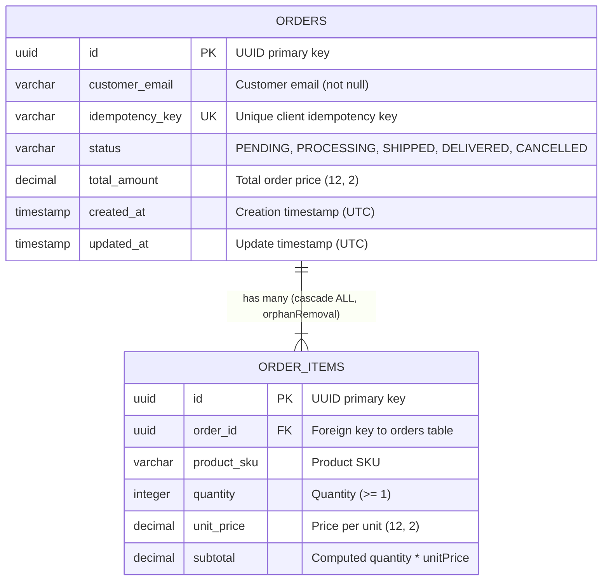

# E-Commerce Order Processing System (v1)

A production-grade, enterprise-ready backend implementation for an **E-Commerce Order Processing System** engineered with **Java 21**, **Spring Boot 3.3.x**, **Spring Data JPA**, **Spring Scheduler**, and **OpenAPI/Swagger**.

---

## 📌 Table of Contents
1. [About the Project](#-about-the-project)
2. [Architecture & Design Decisions](#-architecture--design-decisions)
3. [Database Architecture](#-database-architecture)
4. [API Versioning & Endpoints Specification (v1)](#-api-versioning--endpoints-specification-v1)
5. [Corner Cases & Duplicate Order Protection](#-corner-cases--duplicate-order-protection)
6. [Interactive API Documentation (Swagger/OpenAPI)](#-interactive-api-documentation-swaggeropenapi)
7. [Postman Collection Export](#-postman-collection-export)
8. [Automated Test Suite & Scenarios](#-automated-test-suite--scenarios)
9. [Running the Application](#-running-the-application)
10. [Running the Automated Tests](#-running-the-automated-tests)

---

## 📖 About the Project

The system manages the end-to-end lifecycle of e-commerce customer orders. It provides strict state transitions, defensive validation of order items and monetary subtotals, race-condition-free background batch processing via automated schedulers, client idempotency to prevent duplicate orders, and full pagination and sorting support.

### Key Capabilities
- **Strict Non-Reversible Lifecycle**:
  $$\text{PENDING} \longrightarrow \text{PROCESSING} \longrightarrow \text{SHIPPED} \longrightarrow \text{DELIVERED}$$
- **Conditional Cancellation**: Orders can **only** be transitioned to `CANCELLED` when in `PENDING` status. Cancellation attempts on any other state are rejected with `400 Bad Request`.
- **Atomic Background Scheduler**: A recurring job (default every 5 minutes) batch-transitions all `PENDING` orders directly in the database without loading entity graphs into memory, eliminating race conditions.
- **Idempotency & Duplicate Order Prevention**: Supports client-supplied idempotency keys via the JSON request payload or HTTP `Idempotency-Key` header. Prevents duplicate charges and submissions by returning `409 Conflict`.
- **Defensive Line Item Validation**: Rejects duplicate product SKUs within the same order submission, ensures positive pricing, and calculates item subtotals and order totals automatically.
- **Spring Data Pagination & Sorting**: Zero-overhead pagination and configurable multi-field sorting on order queries.

---

## 🏗️ Architecture & Design Decisions

### 1. Technology Stack
- **Java 21**: Utilizes records for immutable DTOs (`CreateOrderRequest`, `OrderItemDTO`, `OrderResponse`, `PagedResponse`), pattern matching, and enhanced type safety.
- **Spring Boot 3.3.4**: Clean microservice framework with embedded Apache Tomcat and Spring Data JPA.
- **Springdoc OpenAPI 2.6.0**: Automated OpenAPI 3.0 specification and interactive Swagger UI.
- **In-Memory H2 Database**: Fast, zero-friction local and CI/CD testing with embedded console browsing.
- **Docker & Docker Compose**: Multi-stage production container build on Alpine Linux JRE 21 with a non-root security context.

### 2. Concurrency & Isolation
- **Isolation Level `REPEATABLE_READ`**: Used during order cancellation (`cancelOrder`) to eliminate phantom reads and dirty state transitions.
- **Atomic Database-Level Batch Transition**: Implemented via `@Modifying(clearAutomatically = true, flushAutomatically = true)` and `@Transactional` custom JPQL in `OrderRepository`. No entity collections are held in memory, preventing concurrent scheduler-vs-cancellation race conditions.

### 3. API Versioning Best Practices
The system adheres to REST URI Versioning (`/api/v1/orders`), enabling smooth evolution, backward compatibility, and explicit contract boundaries.

---

## 🗄️ Database Architecture

The application uses an in-memory H2 database configured with persistent mode for local sessions (`jdbc:h2:mem:ordersdb;DB_CLOSE_DELAY=-1;DB_CLOSE_ON_EXIT=FALSE`).

### Entity Relationship Diagram (ERD)



### H2 Database Console
- **URL**: `http://localhost:8080/h2-console`
- **JDBC URL**: `jdbc:h2:mem:ordersdb`
- **Username**: `sa`
- **Password**: *(leave blank)*

---

## 🛣️ API Versioning & Endpoints Specification (v1)

Base URL: `http://localhost:8080/api/v1/orders`

### 1. Create Order
- **Method & Path**: `POST /api/v1/orders`
- **Headers**:
  - `Content-Type: application/json`
  - `Idempotency-Key: idem-optional-uuid` *(Optional header)*
- **Request Payload** (clean business payload without transport/infrastructure keys):
  ```json
  {
    "customerEmail": "candidate@example.com",
    "items": [
      {
        "productSku": "PROD-101",
        "quantity": 2,
        "unitPrice": 29.99
      },
      {
        "productSku": "PROD-202",
        "quantity": 1,
        "unitPrice": 49.99
      }
    ]
  }
  ```
- **Response**: `201 Created`
  - **Header**: `Location: /api/v1/orders/155f852a-7401-4e6a-be25-0f81ee522463`
  - **Body**:
  ```json
  {
    "id": "155f852a-7401-4e6a-be25-0f81ee522463",
    "customerEmail": "candidate@example.com",
    "idempotencyKey": "idem-9a8b-7c6d-5e4f",
    "status": "PENDING",
    "totalAmount": 109.97,
    "createdAt": "2026-10-23T04:12:03Z",
    "updatedAt": "2026-10-23T04:12:03Z",
    "items": [
      {
        "id": "76ec29a1-cb9e-4c74-8db1-c5db617a78bc",
        "productSku": "PROD-101",
        "quantity": 2,
        "unitPrice": 29.99,
        "subtotal": 59.98
      },
      {
        "id": "b18b4885-3bc7-43ca-9896-bc21008d37aa",
        "productSku": "PROD-202",
        "quantity": 1,
        "unitPrice": 49.99,
        "subtotal": 49.99
      }
    ]
  }
  ```

---

### 2. Retrieve Order by ID
- **Method & Path**: `GET /api/v1/orders/{id}`
- **Response**: `200 OK`
  ```json
  {
    "id": "155f852a-7401-4e6a-be25-0f81ee522463",
    "customerEmail": "candidate@example.com",
    "idempotencyKey": "idem-9a8b-7c6d-5e4f",
    "status": "PENDING",
    "totalAmount": 109.97,
    "createdAt": "2026-10-23T04:12:03Z",
    "updatedAt": "2026-10-23T04:12:03Z",
    "items": [ ... ]
  }
  ```

---

### 3. List Orders with Pagination & Status Filtering
- **Method & Path**: `GET /api/v1/orders?status=PENDING&page=0&size=10&sort=createdAt,desc`
- **Query Parameters**:
  - `status` *(optional)*: Filter by `PENDING`, `PROCESSING`, `SHIPPED`, `DELIVERED`, or `CANCELLED`.
  - `page` *(optional, default: 0)*: Zero-based page index.
  - `size` *(optional, default: 10)*: Number of items per page.
  - `sort` *(optional, default: createdAt,desc)*: Sorting field and direction.
- **Response**: `200 OK`
  ```json
  {
    "content": [
      {
        "id": "155f852a-7401-4e6a-be25-0f81ee522463",
        "customerEmail": "candidate@example.com",
        "status": "PENDING",
        "totalAmount": 109.97,
        "createdAt": "2026-10-23T04:12:03Z",
        "updatedAt": "2026-10-23T04:12:03Z",
        "items": [ ... ]
      }
    ],
    "pageNumber": 0,
    "pageSize": 10,
    "totalElements": 1,
    "totalPages": 1,
    "isFirst": true,
    "isLast": true,
    "hasNext": false,
    "hasPrevious": false
  }
  ```

---

### 4. Cancel an Order
- **Method & Path**: `POST /api/v1/orders/{id}/cancel`
- **Response**: `200 OK` (when order is in `PENDING` status)
  ```json
  {
    "id": "155f852a-7401-4e6a-be25-0f81ee522463",
    "customerEmail": "candidate@example.com",
    "status": "CANCELLED",
    "totalAmount": 109.97,
    "createdAt": "2026-10-23T04:12:03Z",
    "updatedAt": "2026-10-23T04:15:30Z",
    "items": [ ... ]
  }
  ```

---

## 🛡️ Corner Cases & Duplicate Order Protection

The system provides comprehensive error mapping conforming to RFC 7807:

| Scenario / Corner Case | HTTP Status | Error Type / Message |
| :--- | :--- | :--- |
| **Duplicate Order Submission** | `409 Conflict` | Returned when an order with the same `idempotencyKey` already exists. |
| **Duplicate SKUs in Same Order** | `400 Bad Request` | `"Duplicate product SKU 'PROD-101' detected in order items. Combine quantities into a single item."` |
| **Invalid Email / Blank Fields** | `400 Bad Request` | Structured map of field validation messages. |
| **Negative Quantity or Zero Price** | `400 Bad Request` | `"Quantity must be at least 1"` / `"Unit price must be greater than 0"`. |
| **Cancel Non-Pending Order** | `400 Bad Request` | `"Cannot cancel order with id '...' because current status is 'PROCESSING'. Only orders in 'PENDING' status can be cancelled."` |
| **Order Not Found** | `404 Not Found` | `"Order not found with id: ..."` |
| **Malformed UUID in Path** | `400 Bad Request` | `"Parameter 'id' has invalid value '...'"` |
| **Out-of-Range Pagination** | `200 OK` | Returns empty `content: []` array while preserving `totalElements`. |

### Standard Error Response Example
```json
{
  "timestamp": "2026-10-23T04:12:03Z",
  "status": 409,
  "error": "Conflict",
  "message": "An order with idempotency key 'idem-9a8b-7c6d-5e4f' has already been placed.",
  "path": "/api/v1/orders"
}
```

---

## 🌐 Interactive API Documentation (Swagger/OpenAPI)

Once the application is running, the interactive Swagger UI and raw OpenAPI 3.0 JSON specification are immediately accessible:

* **Interactive Swagger UI**: [http://localhost:8080/swagger-ui.html](http://localhost:8080/swagger-ui.html)
* **OpenAPI 3.0 Spec (JSON)**: [http://localhost:8080/v3/api-docs](http://localhost:8080/v3/api-docs)

---

## 📬 Postman Collection Export

A complete, self-contained Postman collection is exported in the root directory:
- **File**: `postman_collection.json` (Format: Postman Collection v2.1)

### How to Import and Use:
1. Open **Postman**.
2. Click **Import** (top left) and select `postman_collection.json`.
3. The collection is configured with variables:
   - `baseUrl`: default `http://localhost:8080`
   - `orderId`: automatically captured from the `Create Order (Success)` response.
4. Execute requests sequentially across the 3 folders:
   - `1. API Documentation & Schema`
   - `2. Normal Flow Operations`
   - `3. Corner Cases & Duplicate Order Protection`

---

## 🧪 Automated Test Suite & Scenarios

The automated test suite spans **31 automated tests** covering unit, integration, concurrency, and validation layers with **0 failures and 0 errors**.

```text
[INFO] Tests run: 15, Failures: 0, Errors: 0, Skipped: 0 -- OrderControllerIntegrationTest
[INFO] Tests run: 1,  Failures: 0, Errors: 0, Skipped: 0 -- OrderStatusSchedulerIntegrationTest
[INFO] Tests run: 15, Failures: 0, Errors: 0, Skipped: 0 -- OrderServiceTest
[INFO] ------------------------------------------------------------------------
[INFO] Total Tests: 31, Failures: 0, Errors: 0, Skipped: 0
[INFO] BUILD SUCCESS
```

### Verified Test Matrix:
1. **Normal Flow**:
   - Order creation with multi-item calculation.
   - Retrieval by UUID.
   - Default pagination and status-filtered pagination.
   - Order cancellation on `PENDING` state.
2. **Duplicate Order Protection**:
   - Rejection of identical idempotency keys with `409 Conflict`.
   - Idempotency key supplied via HTTP `Idempotency-Key` header.
3. **Corner Cases & Negative Paths**:
   - Rejection of duplicate SKUs within the same order (`400 Bad Request`).
   - Invalid email format and empty line items (`400 Bad Request`).
   - Negative quantity / zero unit price (`400 Bad Request`).
   - Non-existent order retrieval (`404 Not Found`).
   - Malformed UUID syntax in URL path (`400 Bad Request`).
   - Cancellation rejected for `PROCESSING`, `SHIPPED`, `DELIVERED`, and `CANCELLED` (`400 Bad Request`).
   - Pagination page out-of-bounds corner case (`200 OK` with empty content).
4. **Scheduler & Concurrency Integration**:
   - Seeds multiple orders (`PENDING`, `SHIPPED`, `DELIVERED`, `CANCELLED`).
   - Triggers the scheduled batch cron logic.
   - Verifies that all `PENDING` orders atomically transition to `PROCESSING` while other statuses remain strictly untouched.

---

## 🚀 Running the Application

### Option A: Local Execution via Maven Wrapper
Ensure **JDK 21** is installed.

```bash
# 1. Run the Spring Boot application
./mvnw spring-boot:run
```
The server will start up on `http://localhost:8080`.

---

### Option B: Running with Docker & Docker Compose
Ensure **Docker** and **Docker Compose** are installed and running.

```bash
# 1. Build the multi-stage image and start the container
docker compose up --build

# 2. To run in background (detached mode)
docker compose up -d

# 3. View live logs
docker compose logs -f

# 4. Stop the container
docker compose down
```

---

## 🔬 Running the Automated Tests

To run the entire automated unit and integration test suite:

```bash
./mvnw clean test
```
All 31 test cases will execute against the in-memory H2 database.
